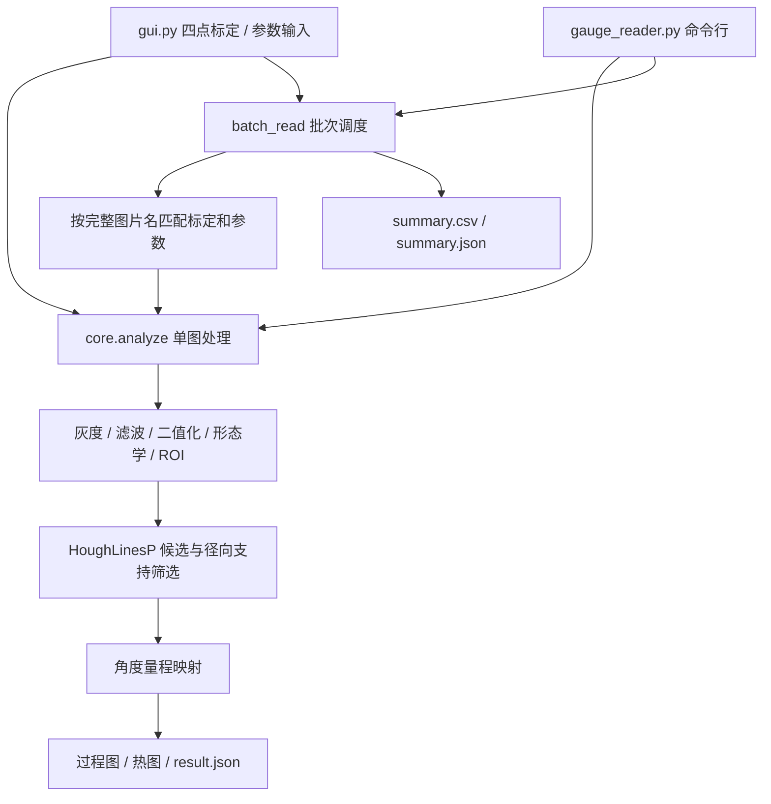

# 架构说明

系统采用算法核心、任务调度、用户界面三层结构。CLI 和 GUI 共用同一套算法，不维护两套识别规则。

## 数据契约

- `Calibration`：归一化圆心、半径、起止角度、递增方向和真实量程；只能在同表盘同机位下复用。
- `Params`：图像处理和拒识参数。公共参数可被逐图 `.params.json` 覆盖。
- `result.json`：保存实际参数、标定、状态、读数或失败原因。人工读数在拒识时保留，误差仅在算法输出时计算。
- 参考 CSV：必需 `filename,manual_value` 表头；按带扩展名的图片名匹配，空值跳过，0 为有效参考值。
- 批次隔离单图异常和写入错误；根目录不可写时无法保证汇总保存，调用方得到异常。

## 算法边界

角度约定右 0°、上 90°；霍夫热图 theta 则是直线法线角。最高峰未必属于指针。针尖方向由圆心附近线段及两侧径向支持判定，随后进行线性量程映射。

霍夫圆只局部修正圆心和半径，不读取刻度、单位或旋转。支持不足、方向冲突和量程外会拒识，但启发式拒识不能发现所有错误。

## 测试和维护

`algorithm_verify.BoundaryTests` 检查映射与图像识别边界；`test_batch_sequence_match` 检查匹配、异常隔离和文件保护；`test_heatmap` 检查热图峰值。`algorithm_verify.py` 主程序另外执行十张合成图端到端验证。GUI 使用工作线程计算、主线程更新 Tk 控件。

保留根目录入口以兼容现有运行习惯。新增算法应进入 `core.py` 或拆分明确模块，并保持 CLI/GUI 共用；真实实验结果不能被合成验证替代。
